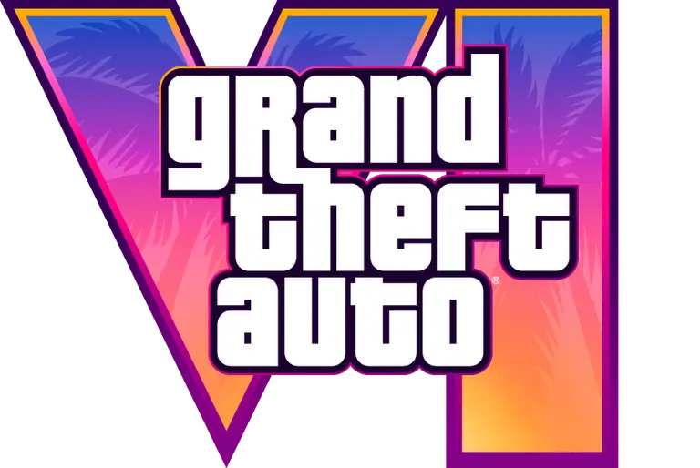

<a name="readme-top"></a>

<div align="center">



# Grand Theft Auto VI — Landing Page

A scroll-driven recreation of the Grand Theft Auto VI landing page, built with Astro, Tailwind CSS and GSAP.

[Report a bug](https://github.com/zakariaelqannaa-dv/landing-gta-vi/issues/new?labels=bug) · [Request a feature](https://github.com/zakariaelqannaa-dv/landing-gta-vi/issues/new?labels=enhancement)

[![Astro][astro-badge]][astro-url]
[![Tailwind CSS][tailwind-badge]][tailwind-url]
[![GSAP][gsap-badge]][gsap-url]
[![License: MIT][license-badge]][license-url]

</div>

---

## Table of contents

- [About](#about)
- [Features](#features)
- [Tech stack](#tech-stack)
- [Getting started](#getting-started)
- [Scripts](#scripts)
- [Project structure](#project-structure)
- [Customization](#customization)
- [Deployment](#deployment)
- [License](#license)
- [Disclaimer](#disclaimer)

<p align="right"><a href="#readme-top">Back to top</a></p>

## About

This project is a fan-made, front-end recreation of the official **Grand Theft Auto VI** landing page. It focuses on the cinematic, scroll-driven reveal of the GTA VI key art and on a clean, accessible implementation of the supporting content.

The site is fully static: it ships almost no JavaScript by default. The only client-side code is the small GSAP timeline that drives the hero animation, the lazy YouTube facade, and the live countdown.

<p align="right"><a href="#readme-top">Back to top</a></p>

## Features

- **Scroll-driven hero.** The GTA wordmark acts as a CSS `mask-image` that zooms out across a sticky `320vh` stage, revealing the key art underneath. The whole sequence is choreographed with a single GSAP `ScrollTrigger` timeline.
- **Trailer 2 facade.** The trailer is loaded from `youtube-nocookie.com` only after the user presses play, so no third-party scripts (or cookies) load up front.
- **Live countdown.** A real-time countdown to the announced launch date, kept in sync through a `role="status"` announcement for screen readers.
- **Platform tiles.** Launch platforms (PlayStation 5 and Xbox Series X|S) displayed as neon-framed tiles using their official logos.
- **Accessible by default.** Skip link, screen-reader-only headings, visible focus rings, `autoAlpha` so faded-out controls leave the tab order, and a complete `prefers-reduced-motion` fallback.
- **SEO ready.** Canonical URL, Open Graph and Twitter card metadata, `theme-color`, and a preloaded display font.

<p align="right"><a href="#readme-top">Back to top</a></p>

## Tech stack

- **[Astro 7][astro-url]** — static site generation with zero JavaScript by default.
- **[Tailwind CSS 4][tailwind-url]** — styling, wired in through the `@tailwindcss/vite` plugin.
- **[GSAP 3][gsap-url]** + ScrollTrigger — the scroll choreography of the hero.
- **TypeScript** — strict type checking across `.astro` files.

<p align="right"><a href="#readme-top">Back to top</a></p>

## Getting started

### Prerequisites

- **Node.js `>= 22.12`** — required by Astro 7. Install it via [nvm](https://github.com/nvm-sh/nvm) if you like.
- **npm** — ships with Node.js.

### Installation

1. Clone the repository.

   ```sh
   git clone https://github.com/zakariaelqannaa-dv/landing-gta-vi.git
   cd landing-gta-vi
   ```

2. Install the dependencies.

   ```sh
   npm install
   ```

3. Start the development server.

   ```sh
   npm run dev
   ```

The site is now running at [`http://localhost:4321`](http://localhost:4321).

<p align="right"><a href="#readme-top">Back to top</a></p>

## Scripts

| Command           | Description                                        |
| ----------------- | -------------------------------------------------- |
| `npm run dev`     | Start the dev server with hot reload.              |
| `npm run build`   | Build the production site into `./dist`.           |
| `npm run preview` | Preview the production build locally.              |
| `npm run astro`   | Run the Astro CLI (e.g. `npm run astro -- --help`). |

<p align="right"><a href="#readme-top">Back to top</a></p>

## Project structure

```text
.
├── public/
│   ├── fonts/              # GTA display fonts (regular / bold / semibold / narrow)
│   ├── favicon.svg
│   └── logo-stack.svg      # Source of the hero mask
├── src/
│   ├── assets/             # SVG icons and hero imagery
│   ├── components/
│   │   ├── Intro.astro     # Scroll-driven hero (sticky stage + GSAP timeline)
│   │   ├── Trailer.astro   # Trailer 2 facade player
│   │   ├── Release.astro   # Countdown and platform tiles
│   │   └── SiteFooter.astro
│   ├── layouts/
│   │   └── Layout.astro    # <head>, SEO metadata and global styles
│   ├── pages/
│   │   └── index.astro     # Page composition
│   └── styles/
│       └── global.css
├── astro.config.mjs
└── package.json
```

<p align="right"><a href="#readme-top">Back to top</a></p>

## Customization

| What                | Where                                                        |
| ------------------- | ------------------------------------------------------------ |
| Launch date         | `RELEASE_DATE` in [`src/components/Release.astro`](src/components/Release.astro) |
| Trailer video       | `TRAILER_ID` in [`src/components/Trailer.astro`](src/components/Trailer.astro)   |
| Page title / meta   | `Props` in [`src/layouts/Layout.astro`](src/layouts/Layout.astro)                |
| Production URL      | `site` in [`astro.config.mjs`](astro.config.mjs)             |

> Setting `site` in `astro.config.mjs` makes the canonical and Open Graph URLs absolute, which is recommended before deploying.

<p align="right"><a href="#readme-top">Back to top</a></p>

## Deployment

The build is fully static:

```sh
npm run build
```

This outputs the site to `./dist`, which can be served from any static host — Vercel, Netlify, Cloudflare Pages, GitHub Pages, or a plain object store. Remember to set `site` in `astro.config.mjs` to your deployed origin first.

<p align="right"><a href="#readme-top">Back to top</a></p>

## License

Released under the [MIT License](LICENSE).

Copyright (c) 2026 **zakariaelqannaa-dv**.

<p align="right"><a href="#readme-top">Back to top</a></p>

## Disclaimer

This is a fan-made, non-commercial project created for learning and demonstration purposes. It is **not** affiliated with, endorsed by, or sponsored by Rockstar Games or Take-Two Interactive. *Grand Theft Auto*, *GTA*, *Vice City* and all related trademarks, imagery and assets remain the property of their respective owners.

<p align="right"><a href="#readme-top">Back to top</a></p>

[astro-url]: https://astro.build/
[tailwind-url]: https://tailwindcss.com/
[gsap-url]: https://gsap.com/
[license-url]: LICENSE
[astro-badge]: https://img.shields.io/badge/Astro-7-BC52EE?style=for-the-badge&logo=astro&logoColor=white
[tailwind-badge]: https://img.shields.io/badge/Tailwind_CSS-4-06B6D4?style=for-the-badge&logo=tailwindcss&logoColor=white
[gsap-badge]: https://img.shields.io/badge/GSAP-3-88CE02?style=for-the-badge&logo=greensock&logoColor=white
[license-badge]: https://img.shields.io/badge/License-MIT-yellow.svg?style=for-the-badge
